<h2 align="center">Hi, I'm Leon </h2>

  Mobile & web developer building <b>Leon Store</b> — a full ecosystem of
  mobile app, website, API, and supplier system.

<h2 align="center">Hi, I'm Leon </h2>

  

  Mobile & web developer building <b>Leon Store</b> — a full ecosystem of
  mobile app, website, API, and supplier system.

  

### 🛒 What I'm working on
- **Leon Store** — main store app built with Flutter
- **LeonStore Web** — storefront built with JavaScript
- **API** — backend that connects the app, web, and suppliers
- **Supplier App** — tools for managing supplier products

### 🖥 Skills

  
  
  
  
  
  
  

### 📊 GitHub Stats

  
  

### 📫 Connect

  
  
  

